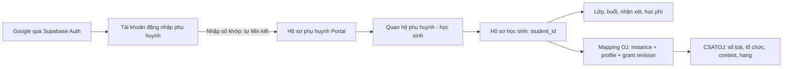
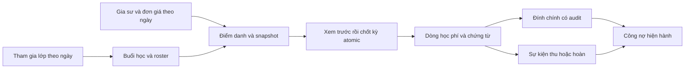

# Học sinh, phụ huynh và CSATOJ: cấu trúc dữ liệu và hướng chuyển đổi

> Bản nghiên cứu trước triển khai. Mã local nay có migration30–32 và các luồng Google/grants/thu tiền/chứng chỉ. Hiện trạng và hướng dẫn thao tác được cập nhật tại [runbook chuyển đổi](PORTAL_GOOGLE_GRANTS_ROLLOUT.md) và [PROJECT_STATUS](PROJECT_STATUS.md); các mục “chưa có/chưa chốt” dưới đây chỉ mô tả baseline nghiên cứu.

Đây là kết quả nghiên cứu schema/mã và thiết kế để triển khai tiếp, không phải migration đã áp dụng. Quyết định sản phẩm ở [DECISIONS](DECISIONS.md); bằng chứng theo môi trường ở [PROJECT_STATUS](PROJECT_STATUS.md). Bản đối chiếu tổng thể ở [PORTAL_DEVELOPMENT_REVIEW](PORTAL_DEVELOPMENT_REVIEW.md).

## Luồng sản phẩm đã chốt

1. Admin quản lý hồ sơ học sinh và thông tin phụ huynh tại Portal.
2. Admin OJ tạo mã kết nối; admin Portal chọn học sinh và đổi mã để gắn tài khoản CSATOJ. Mã này không dành cho phụ huynh.
3. Phụ huynh đăng nhập Google, nhập số điện thoại. Khi số khớp hồ sơ phụ huynh hợp lệ đã gắn học sinh, hệ thống tự liên kết ngay, **không OTP, không admin duyệt, không mã mời Portal**.
4. Chỉ hỗ trợ **một tài khoản phụ huynh – một số điện thoại – một học sinh**. Một học sinh chỉ có một phụ huynh được liên kết. Số đã được tài khoản Google nhận liên kết thì Google khác bị từ chối; không chuyển quyền hoặc ghi đè chủ liên kết.
5. Phụ huynh đọc thông tin học tập/học phí Portal và dữ liệu OJ của học sinh duy nhất được liên kết. Admin xem được mối liên hệ giữa hồ sơ Portal, phụ huynh và tài khoản OJ.

Google xác thực tài khoản Google, không xác minh số nhập tại Portal hoặc quan hệ cha mẹ–con. Theo lựa chọn trực tiếp của chủ trung tâm, biết số đăng ký chưa được nhận liên kết vẫn có thể nhận quyền xem. Số đã có chủ phải bị từ chối với tài khoản khác. SEC-02 không được đóng chỉ vì thêm OAuth; lưu nguồn liên kết là khớp số tự khai, không ghi `phone_verified`.

Các docs bàn giao OJ hiện còn yêu cầu mã mời phụ huynh. Quyết định mới thay phần quyền phụ huynh do Portal sở hữu; không thay hợp đồng kỹ thuật exchange/grant/revision của OJ. Chưa sửa repo OJ, chưa coi docs hai phía đã đồng bộ.

## Hai liên kết độc lập, học sinh là điểm nối

Đây là sơ đồ đích. Trong mã hiện tại, `students` là hồ sơ nghiệp vụ, **không có `auth_uid` hoặc cơ chế đăng nhập học sinh**. Yêu cầu liên kết tài khoản học sinh OJ không tự bao gồm việc xây thêm đăng nhập học sinh Portal. Dùng `student_id` ổn định làm khóa; tên, phone và username không thay khóa này.

Đích mới là quan hệ một–một, thay đề xuất nhiều con/nhiều phụ huynh trước đây. Schema hiện có vẫn nhiều–nhiều và cần migration mới để áp ràng buộc. Thu hồi quyền phụ huynh không tự thu hồi grant OJ của học sinh. OJ không quản lý Auth Google, liên hệ phụ huynh, học phí hay điểm danh Portal.

## Schema đang có

| Miền / bảng | Khóa và quan hệ đáng chú ý | Ý nghĩa hiện tại |
|---|---|---|
| `students` | PK `student_id`; `parent_name`, `parent_number`, `parent_link`, `student_contact`, trạng thái/xóa mềm | Hồ sơ học sinh và thông tin liên hệ nhập liệu; không phải tài khoản Auth |
| `parent_accounts` | PK `parent_id`; `phone` unique chuẩn `0xxxxxxxxx`; `active`; `auth_uid` unique và `legacy_auth_uid` unique còn giữ | Hồ sơ liên hệ/quyền cũ; tên bảng không có nghĩa đang dùng Auth |
| `parent_student_links` | PK `(parent_id, student_id)`; FK parent `CASCADE`, student `RESTRICT` | Quan hệ nhiều–nhiều; có người/thời điểm tạo, chưa có trạng thái/revision/thu hồi riêng |
| `parent_lookup_sessions` | PK hash token; FK parent; hạn dùng; các cột Auth còn giữ nhưng phiên mới để null | Phiên tra cứu 12 giờ ở migration27, không Google |
| `tutors` | `tutor_id`, `auth_uid`, trạng thái hoạt động | Vai trò/phân công gia sư; không tự gán người mới đăng nhập Google thành gia sư |
| `classes`, `class_students` | Lớp và quan hệ học sinh–lớp hiện có | Không đủ để suy roster hoặc đơn giá của một buổi quá khứ |
| `class_enrollments` | Khoảng `joined_on`/`left_on`; unique một đợt mở cho mỗi học sinh–lớp | Lịch sử tham gia; dữ liệu baseline thiếu ngày không được tự suy ngày bắt đầu |
| `class_tutor_history`, `class_fee_history`, `student_fee_history` | Ngày hiệu lực, actor, lý do; chỉ số theo ngày | Phân công và đơn giá tại ngày buổi học |
| `sessions`, `session_attendance` | Buổi, học sinh, trạng thái, snapshot giá/gia sư, kỳ đã chốt | Điểm danh có quyền và nguồn giá; dữ liệu đã chốt được bảo vệ |
| `billing_periods`, `billing_sessions`, `billing_items` | Kỳ → buổi snapshot → dòng học phí, liên hệ `payments` | Chứng từ gốc giữ nguyên; học sinh vắng không bị biến thành khoản học phí có mặt |
| `billing_adjustments`, `payment_events` | Đính chính và sự kiện thu/hoàn/đảo, actor/lý do | Điều chỉnh công nợ khác với thu tiền; không sửa trực tiếp trạng thái paid thay ledger |
| `learning_records`, `learning_history`, `student_reviews`, `review_corrections` | Ngữ cảnh học sinh/lớp/buổi/tháng; nháp/công bố, revision/lịch sử | Phụ huynh chỉ nhận projection được công bố |
| `oj_links`, `oj_link_outbox`, `oj_target_claims` | Migration28 local cũ; kind student/class/session, payload JSON, revision | Đồng bộ bindings cũ; chưa phải mô hình grants mới |
| `business_audit_events`, `csat_internal.operation_results` | Audit và idempotency nghiệp vụ | Không mặc định mọi bảng mới đã có audit chỉ vì bảng audit tồn tại |

Đã dựng schema **trong bộ nhớ PGlite**, từ fixture trước kế toán rồi áp đủ 25 migration 05–29: thành công; 44 bảng public đều bật RLS, 6 bảng `csat_internal` có 2 bảng bật RLS. Đây là metadata của schema giả dựng từ repo, không phải production. Schema nội bộ còn dựa thu hồi quyền/SECURITY DEFINER; số bảng có RLS không tự chứng minh quyền đúng.

Migration02 gắn parent trực tiếp Auth → 03 tách `parent_id`, giữ `legacy_auth_uid` → 16 chuẩn hóa phone → 26 thêm `auth_uid`/phiên mật khẩu → 27 thu hồi RPC Auth, trở về lookup → 29 đổi budget. Không chạy lại 26 để có Google. Migration28 phụ thuộc27 nhưng độc lập29; phải xác minh registry môi trường trước quyết định chuyển bảng cũ, không sửa migration đã phát hành.

## Những chỗ lệch cần xử lý trước khi phát triển

| Phát hiện từ mã/schema | Hệ quả cho luồng mới |
|---|---|
| `features/students/actions.ts` thêm/sửa `students` trực tiếp; trigger chỉ chuẩn hóa phone, không tạo/sửa `parent_accounts` và links | Số trong hồ sơ học sinh có thể khác nguồn quyền phụ huynh; cần một thao tác quản lý liên hệ thống nhất |
| Import phụ huynh có preview token, kiểm tên/số, khóa transaction và đối chiếu nguồn lại | Tận dụng để chuẩn hóa dữ liệu cũ; không chạy import rộng ngay trong OAuth callback |
| `admin_save_parent_contact` thay toàn bộ tập links; chưa nhận expected revision | Khóa row ngăn ghi xen kẽ nhưng chưa chặn form cũ ghi đè tập liên kết mới; cần revision khi chuẩn hóa |
| API admin parents update giữ nguyên phone cũ dù RPC nhận phone | Luồng đổi số cần sửa cả UI/API/RPC và thu hồi quyền gắn số cũ; không chỉ thay input |
| GET admin parents `view=provisioning` vẫn gọi `parent_auth_candidates`, đã bị27 thu hồi; thông báo tạo hồ sơ còn nói cấp tài khoản qua công cụ | Caller/thông báo lịch sử phải chuyển sang quản lý liên kết Google; không cấp lại quyền RPC cũ để hết lỗi |
| Catalog schema sau29 chỉ có trigger chuẩn hóa trên `students`/`parent_accounts`, không có audit trigger trên `parent_student_links` | Bổ sung audit thao tác liên hệ, tự liên kết và thu hồi; không tuyên bố mọi thay đổi quyền đã có audit |
| `parent_accounts` có unique phone/Auth nhưng `parent_student_links` chỉ unique cặp khóa | Đích đã chốt một Google/một phone/một parent/một student; cần unique từng phía và thao tác nhận liên kết atomic, không chỉ kiểm tra trước rồi insert |
| `authRedirect` mặc định thiếu role là tutor; proxy bỏ qua refresh Auth trên `/parents` và `/api/parents/*` | Cần sửa phân loại user mới, refresh/callback/đăng xuất cùng đợt; quyền vẫn phải kiểm ở API/RPC |
| `parentSession` + RPC/readers đang nhận lookup hash | Phải chuyển cả trang cha, bài chuyên đề, OJ API và đăng xuất; đổi riêng màn hình login chưa đủ |

Nguồn: `app/api/admin/parents/route.ts`, `app/api/admin/parents/import/route.ts`, `lib/parent-import.ts`, `lib/parents.ts`, `lib/parent-auth.ts`, `lib/auth-routing.ts`, `proxy.ts`; migrations03/16/26/27 và catalog PGlite sau29.

## Mô hình triển khai đề xuất

Các tên bảng/field dưới đây là thiết kế, **chưa tồn tại hoặc chưa được migrate**. Quy tắc tự liên kết đã chốt; các chi tiết lưu trữ còn cần hoàn thiện khi triển khai.

- Tái sử dụng nền schema `students`, `parent_accounts`, `parent_student_links`; dữ liệu vận hành hiện tại sẽ được xóa và nhập lại theo quyết định mới, phạm vi thực thi ở mục reset bên dưới. Chọn `parent_accounts.phone` + link duy nhất làm nguồn khớp quyền; `students.parent_number` là dữ liệu nhập liệu cần đồng bộ, không làm đường phụ để mở hồ sơ ngoài link.
- Thêm bảng liên kết danh tính, ví dụ `parent_identity_links`: Auth user → parent ID, trạng thái, revision, cách liên kết `phone_match`, thời điểm/người tạo/thu hồi và lý do. Ràng buộc unique Auth user và parent ID cho chủ liên kết; `parent_accounts.phone` unique sau chuẩn hóa; quan hệ học sinh unique riêng `parent_id` và `student_id`. Có thể tách audit khỏi bản ghi chủ liên kết để giữ lịch sử mà vẫn cưỡng chế một–một. Dùng Auth user ID/danh tính Google ổn định, không dùng chuỗi email làm khóa. Giữ toàn bộ tài khoản Supabase Auth theo quyết định reset; không ghi đè danh tính còn giữ.
- Lưu audit và trạng thái chặn đủ để tài khoản đã bị thu hồi không tự nhận lại quyền chỉ bằng nhập lại cùng số. Đổi số hoặc gắn sai con phải vô hiệu hóa liên kết liên quan theo transaction; không chỉ xóa cookie trình duyệt hiện tại. Đây là quy tắc kỹ thuật đề xuất để thu hồi có tác dụng.
- Endpoint nhập phone yêu cầu phiên Google hợp lệ, kiểm Origin/schema/rate limit. Chuẩn hóa số toàn phần bằng quy tắc TS/SQL hiện có; không so đuôi số, không dùng tên Google/email làm quan hệ phụ huynh. Server tự tìm parent ID; không nhận student IDs tùy ý từ client.
- Tự liên kết hợp lệ trong transaction, kiểm trạng thái và revision nguồn; request lặp từ cùng tài khoản trả cùng kết quả. Nếu phone đã thuộc tài khoản khác, trả HTTP 409 với mã dự kiến `PHONE_ALREADY_LINKED` và thông báo “Số điện thoại đã được liên kết với tài khoản phụ huynh khác”; không tiết lộ Gmail, tên hoặc dữ liệu học sinh. Hai Google tranh cùng số chỉ một được thành công, dùng khóa/unique DB chứ không chỉ kiểm tra tại API. Tài khoản đã có con không được nhận thêm phone/con khác. Không khớp thì trả trạng thái chưa liên kết/liên hệ trung tâm, không tự tạo học sinh hoặc liệt kê khớp một phần. Hồ sơ khóa/thu hồi không tự giải phóng số để Google khác nhận; đổi chủ cần luồng quản lý riêng có audit.
- Đọc dữ liệu theo Auth user + quyền DB còn hiệu lực; Auth mới chưa có links chỉ thấy onboarding. Role admin/gia sư không được cấp từ metadata do người dùng tự sửa. Không tự hạ vai trò staff đang có khi họ cũng là phụ huynh.
- Mapping OJ riêng, ví dụ `student_oj_accounts`: student ID, instance/profile ID, grant ID, **grant revision OJ** và **revision mapping Portal** tách biệt, trạng thái và nhãn username. Unique hai chiều; thay tài khoản phải giữ audit, chặn dữ liệu mapping cũ và kiểm revision.
- Operation đổi mã OJ lưu request UUID trước HTTP, không lưu mã bản rõ; receipt phục hồi sau lỗi. Pending không được trả như liên kết active. Thêm mapping lớp–organization và buổi–contest ở Portal, giữ roster lịch sử cho class-results.
- Chỉ lưu metadata OJ cần quản lý; số bài/contest/hạng lấy API với `as_of`. Không biến OJ thành nguồn đơn giá, điểm danh hay chứng nhận thành thạo. Admin đọc OJ cũng qua backend và grant được xác nhận.

## Lớp, điểm danh và học phí liên quan thế nào?

`csat_internal.session_roster` kết hợp enrollment theo ngày, xác minh roster và điểm danh đã ghi. OJ không được dùng membership organization hôm nay thay cho roster này. Trước chốt, các buổi cũ thiếu căn cứ phải đối soát, không tự đoán học sinh/giá.

`take_attendance_safe` kiểm quyền/phân công và nguồn đơn giá; `close_billing_period` kiểm preview token/request ID và ghi atomic. `record_payment_event` hiện chỉ admin, ghi toàn bộ số dư theo kỳ/chứng từ, hỗ trợ thu/hoàn/đảo; thao tác này ghi nhận tiền nhận bên ngoài, không chuyển tiền ngân hàng.

Cho gia sư đánh dấu đã thu cần quyền ở API **và RPC**, kiểm chứng từ thuộc phạm vi được phép, actor, số dư kỳ vọng và idempotency. Không cấp chung quyền hoàn tiền, đảo giao dịch hoặc chốt kỳ. Thu từng phần hay toàn bộ, quyền khi đổi gia sư và người xử lý nhầm tiền vẫn cần quyết định nghiệp vụ riêng.

## Phạm vi chuyển đổi và nghiệm thu

1. Xác định môi trường/project và danh mục dữ liệu reset, phạm vi Storage, nguồn nhập mới và phương án khôi phục; giữ toàn bộ tài khoản Supabase Auth. Đối soát registry/quyền bằng kết quả tổng hợp; không đưa danh sách thật vào chat/CI. Dựng và thử schema mới bằng dữ liệu giả trước khi thay database vận hành.
2. Chuẩn hóa nguồn liên hệ và revision/audit; bổ sung identity/mapping bằng migration mới sau số cuối thực tế. Kiểm cả schema tối thiểu và schema có email/hồ sơ19/21/22, có/không OJ28 nếu registry thực khác nhau.
3. Google → nhập số → tự liên kết → đọc Portal; chuyển các reader cùng đợt và thu hồi đường lookup cũ khi cắt chuyển. Không để API chỉ cần phone cũ còn mở song song ngoài kế hoạch tương thích.
4. Admin đổi mã OJ → summary/organizations/contests/class-results → admin và phụ huynh xem cùng tài khoản. Giữ phân biệt số bài thử/AC/lượt nộp, rating/hạng, null/withheld/frozen và cursor.
5. Kiểm một phụ huynh/một con/một số; từ chối thêm con hoặc phụ huynh thứ hai. Cùng Google thử lại nhận kết quả cũ; Google khác dùng số đã nhận phải lỗi409; hai Google nhận cùng số đồng thời chỉ một thành công. Kiểm số nội địa/+84/0084 cùng chuẩn hóa về một số, sai/khóa/đổi số, thu hồi rồi nhập lại và tranh chấp liên kết/thu hồi. Không lộ Gmail/hồ sơ của chủ liên kết qua lỗi.
6. Kiểm OJ mất quyền/revision đổi khi request đang chạy, retry exchange, tài khoản trùng, đổi username, roster thiếu grant, freeze/rejudge, quota chung và phân trang. Không trả roster/danh tính đối thủ cho phụ huynh.
7. Hồi quy quyền gia sư/admin, lớp/điểm danh/chốt/thu/đính chính; chứng minh không đổi học phí hay bản công bố chỉ vì thêm danh tính/OJ. Browser QA dùng fixture, Auth/OJ thật thử trên môi trường riêng.

## Reset để nhập lại từ đầu

Chủ trung tâm đã quyết định xóa dữ liệu database hiện tại để cập nhật thông tin lại từ đầu. Đây là quyết định thay dữ liệu vận hành, thay hướng bảo toàn toàn bộ dữ liệu cũ trong kế hoạch chuyển đổi trước đó; không phải yêu cầu xóa repository, migration, nội dung giáo trình hoặc database CSATOJ.

**Giữ toàn bộ tài khoản đăng nhập Supabase Auth** theo xác nhận tiếp theo của chủ trung tâm; không xóa/tạo lại user hoặc reset mật khẩu trong đợt này. Phải giữ khả năng đăng nhập và đối chiếu lại `tutors.auth_uid`/quyền admin khi tạo dữ liệu nghiệp vụ mới; giữ Auth user không tự khôi phục hồ sơ gia sư hoặc quyền đọc dữ liệu sau reset.

Chưa xác định project/môi trường đích và phạm vi Storage. Không suy “xóa database” thành xóa cả project Supabase, schema Auth, file Storage hoặc tài khoản OJ. Chưa chạy lệnh xóa/reset, chưa đổi schema hay triển khai Google.

Kế hoạch cần dựng schema mới đủ chuỗi migration/quyền, phục hồi quyền admin cho Auth được giữ và khởi tạo dữ liệu nền, rồi nhập lại học sinh–phụ huynh đúng một–một, lớp, phân công và đơn giá. Dữ liệu OJ không bị xóa bởi reset Portal; liên kết lại qua mã/grant và xử lý mapping cũ theo hợp đồng. Khi vận hành lại, vẫn giữ snapshot, audit, nháp/công bố và dùng đính chính cho kỳ đã chốt. Migration đã phát hành giữ nguyên; reset một lần không trở thành cơ chế sửa dữ liệu thường ngày.

## Thông tin hiển thị từng gia sư

Chủ trung tâm yêu cầu thành tích và chứng chỉ đều có nhiều mục, cùng trường đại học và giới thiệu bản thân. Schema/mã local đã có `tutor_public_profiles.achievements` (text, mỗi dòng một mục), `university` và `introduction`; chưa có `certificates`. Không thêm cột trùng vào `tutors` hoặc tự tạo nội dung hồ sơ.

Thiết kế tiếp theo: tái dùng ba trường có sẵn, bổ sung `certificates` qua migration mới, đồng bộ RPC ghi có revision/audit, validation/API/types, form gia sư/admin và projection/thẻ phụ huynh. Chứng chỉ dự kiến dùng text nhiều dòng như thành tích, hiển thị thành danh sách riêng; chưa có yêu cầu upload bằng/chứng chỉ hoặc xác minh chứng chỉ. Quyền sửa và lưu-hiển-thị-ngay giữ theo [hồ sơ gia sư](TUTOR_PROFILES_20260923.md). Đây là thiết kế, chưa có cột chứng chỉ trong mã/migration hiện tại hoặc bằng chứng áp production.
